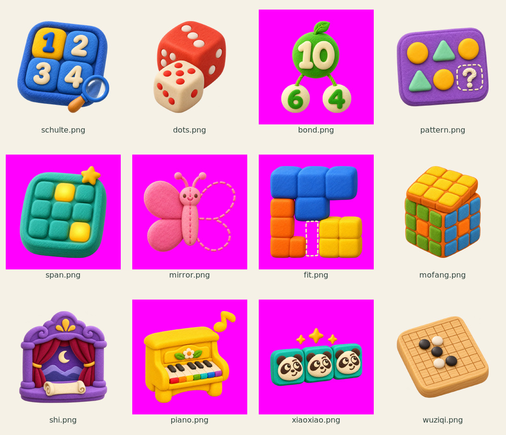
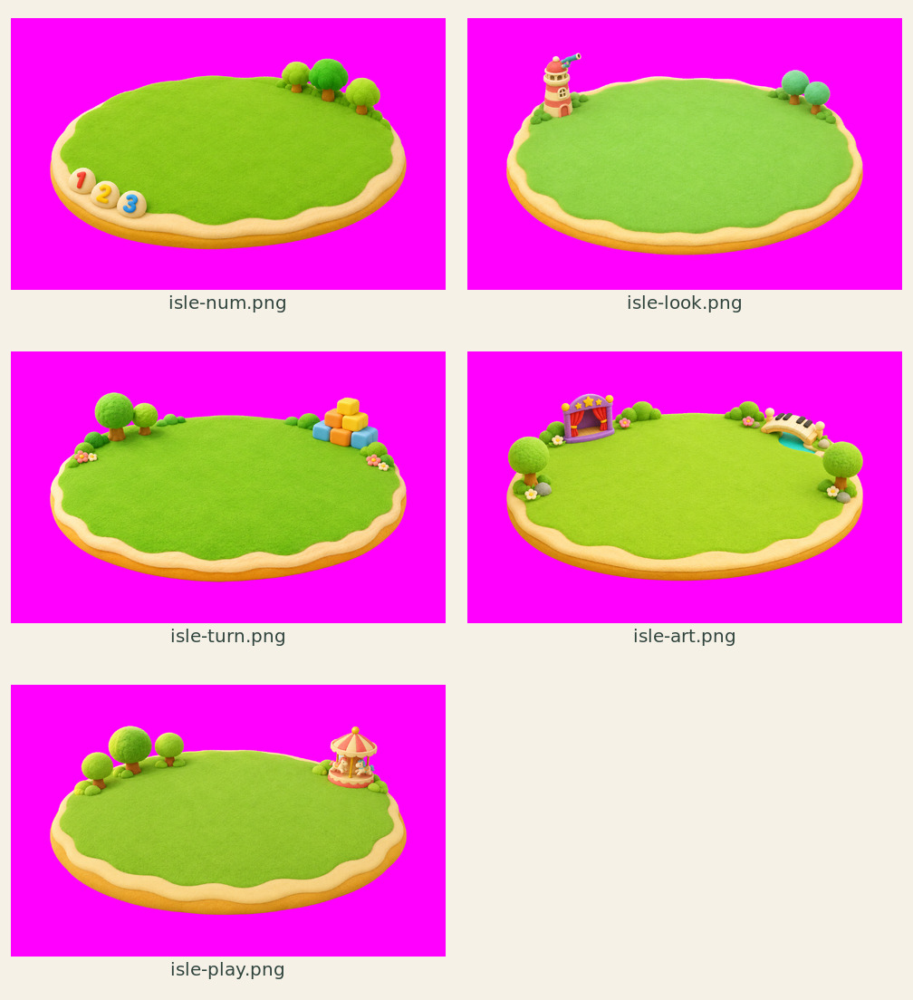
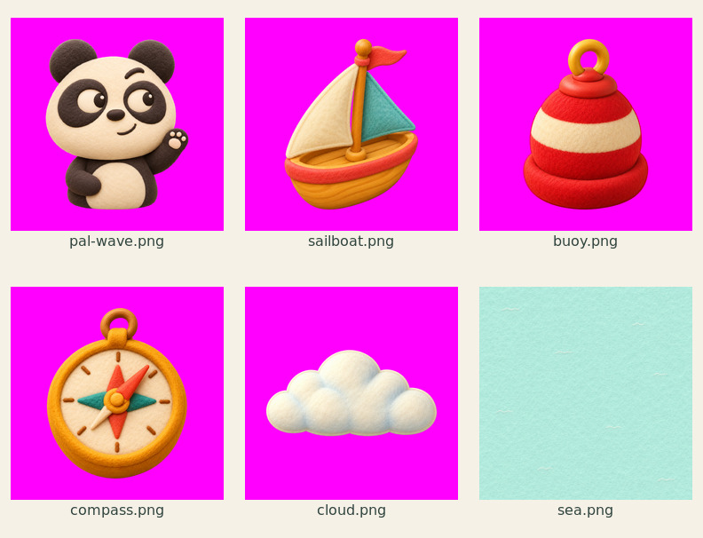
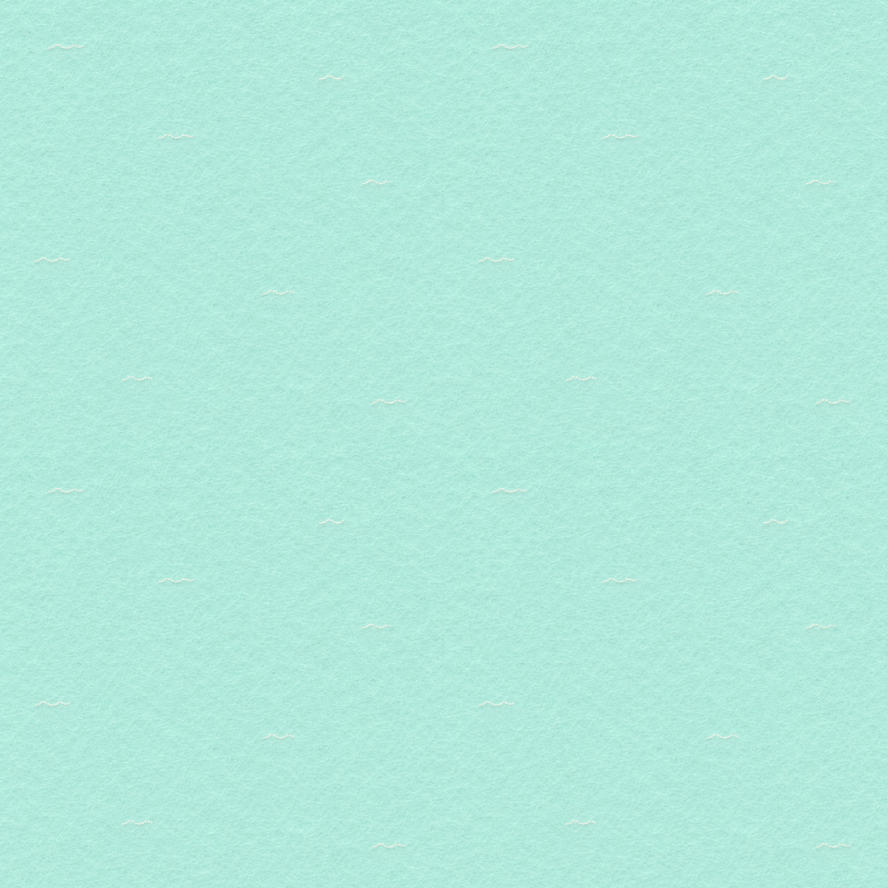

# 思维小画本 · B「梦想群岛」插画交付

按 [PROMPTS.md](PROMPTS.md) 完成 **23 张 PNG**：12 张游戏插画、5 座岛、1 张海面纹理、4 个航海装饰，以及可选的挥手熊猫。

统一采用「怪趣森林」的手工羊毛毡与软陶质感、左上柔光、圆润轮廓。游戏图标和装饰的主体最长边约占画布 80%；5 座岛采用 45° 俯视，标志物收在外围，中央保留空草地供游戏入口使用。

## 文件与尺寸

| 位置 | 内容 | 实际交付尺寸 |
| --- | --- | --- |
| 本目录的 12 个游戏 ID `.png` | 游戏插画 | 1024 × 1024 |
| `pal-wave.png` | 挥手熊猫，上半身 | 1024 × 1024 |
| `b/isle-num.png` | 数一数岛，数字圆石 | 1600 × 1000 |
| `b/isle-look.png` | 看一看岛，灯塔与望远镜 | 1600 × 1000 |
| `b/isle-turn.png` | 转一转岛，方块山 | 1600 × 1000 |
| `b/isle-art.png` | 念一念 · 弹一弹岛，戏台与琴键桥 | 1600 × 1000 |
| `b/isle-play.png` | 玩一玩岛，旋转木马 | 1600 × 1000 |
| `b/sea.png` | 浅青绿毛毡海面，稀疏白色浪花 | 1024 × 1024 |
| `b/sailboat.png`、`buoy.png`、`compass.png`、`cloud.png` | 帆船、浮标、指南针、云朵 | 各 512 × 512 |

## 背景与后续处理

- **6 张透明 PNG**：`schulte.png`、`dots.png`、`pattern.png`、`mofang.png`、`shi.png`、`wuziqi.png`。
- **16 张纯品红底 PNG**：其余 6 张游戏图、挥手熊猫、5 座岛和 4 个航海装饰。复杂镂空与绒面素材采用附件允许的 **#FF00FF** 备选底色，需后续抠图；品红不是成品首页背景。蝴蝶右翅和方块缺口也使用同一底色。
- **1 张不透明海面纹理**：`b/sea.png` 铺满画布，保留为背景纹理。
- PNG 已统一画布尺寸、主体留白与品红底色。抠图、WebP 压缩与首页接入由后续流程处理。

## 总览

总览为缩略检查图，含文件名；取源素材时请使用上面列出的 PNG。

### 12 张游戏插画

### 5 座岛

### 熊猫与航海装饰

### 海面 2 × 2 平铺检查

## 检查与记录

文件名、数量、PNG 格式、RGBA 模式、尺寸、边缘留白、背景类别和 SHA-256 见 [inventory.json](inventory.json)；检查结论和海面接边数据见 [review/validation.json](review/validation.json)。

已逐张检查数字与关键构图，包括 1/2/3/4、五点骰子、10/6/4、两排规律、3×3 按键与两个亮键、左右虚实蝴蝶、T/L/正方形拼块、三阶魔方、戏台月景、七色琴键、三连熊猫和三黑两白棋子。海面通过 2×2 平铺缩略图检查；接边指标记录实际像素差，并非两边逐像素相等的声明。

[generation.json](generation.json) 保留各张素材最后一轮使用的提示词；涉及重绘的提示词以交付图作为后续修改参考。熊猫角色参考仓库已有的 `xiaoxiao/dev/art/heads2/panda.png`。

制作过程已分批提交并推送至 `art/home-dream-islands` 分支。
